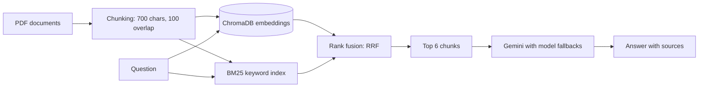

# Civil Engineering Document Assistant

A retrieval-augmented generation (RAG) assistant that answers questions about civil and water resources engineering from PDF documents, and cites the document and page it used.

**Live demo:** https://nur958248-civil-engineering-rag.hf.space

> Demo only. Answers come from the uploaded documents, which may be outdated or may not match your local codes and standards. Verify against the governing standards, and have a licensed engineer check any design decision.

## What makes it more than a basic RAG demo
- **Hybrid retrieval.** Embedding search (`all-MiniLM-L6-v2` + ChromaDB) is combined with a hand-written BM25 keyword index, and the two rankings are merged with reciprocal rank fusion. Embeddings find passages by meaning; BM25 finds exact terms, numbers and phrases that embeddings miss.
- **Page-level citations.** Every chunk keeps its file name and page number, so each answer lists the sources it was built from.
- **Grounded answers.** The prompt tells the model to answer only from the retrieved passages and to say so when they don't contain the answer.
- **Resilient generation.** Gemini calls are retried, fall back to backup models, and failures are classified (quota, rejected key, server busy) so the user sees a useful message.
- **Debuggable.** The app has a panel showing exactly which passages the model received, and the code uses structured `logging`.
- **Evaluation script.** `evaluate.py` runs a set of test questions and reports accuracy, source retrieval and refusal rate.
- **Two front ends.** A Gradio app (deployed on Hugging Face Spaces) and a FastAPI service with a Dockerfile.

## Architecture



## Project structure
```
.
├── app.py               # Gradio web app (Hugging Face Space)
├── api.py               # FastAPI service (/ask, /health)
├── rag_engine.py        # hybrid retrieval + answer generation
├── pdf_loader.py        # PDF text extraction and chunking
├── rag_settings.py      # title, prompt wording, disclaimer, logging setup
├── evaluate.py          # runs eval_questions.json and reports results
├── eval_questions.json  # test questions
├── Dockerfile
├── requirements.txt
├── requirements-api.txt
└── pdfs/                
```

## Run it locally
1. Install the dependencies (Python 3.10 or newer):
   ```
   pip install -r requirements.txt gradio
   ```
2. Put one or more text-based PDFs in the `pdfs/` folder.
3. Set your Gemini API key (never commit it):
   ```
   # Windows PowerShell
   $env:GEMINI_API_KEY="your-key"
   # macOS / Linux
   export GEMINI_API_KEY="your-key"
   ```
4. Start the app:
   ```
   python app.py
   ```

Optional environment variables: `GEMINI_MODEL` (main model) and `GEMINI_FALLBACK_MODELS` (comma-separated backups).

## Run the API with Docker
```
docker build -t civil-rag .
docker run -p 8000:8000 -e GEMINI_API_KEY civil-rag
```
Then open http://localhost:8000/docs and try `POST /ask` with `{"question": "What is the purpose of a slump test?"}`.

## Evaluation
`python evaluate.py` asks every question in `eval_questions.json` and saves the results. Results on my own question set:

| Check | Result |
|---|---|
| Answerable questions answered correctly | _TODO_ / _TODO_ |
| Correct source page retrieved | _TODO_ / _TODO_ |
| Out-of-scope questions correctly refused | _TODO_ / _TODO_ |

_Replace the TODO values with your real results and add one or two sentences on what failed and why._

## Documents used
The PDFs are not included in this repository. List each document here with its publisher, edition and license, for example:
- _Publisher, title, edition/year (license or terms)_

## Limitations
- Formulas and tables in PDFs may not extract cleanly, so answers that depend on them can be wrong or missing.
- Documents can be old and may not match current codes or local standards.
- The assistant retrieves and summarizes text. It does not perform engineering calculations.
- Scanned PDFs without a text layer are not supported (OCR would be needed).
- The index is rebuilt at every start, which is slow for very large collections.

## Tech stack
Python, sentence-transformers, ChromaDB, Google Gemini API, Gradio, FastAPI, Docker, pypdf.

https://github.com/user-attachments/assets/b71fe5c2-d857-4298-b7bf-94b0d5850bd1


